<p align="center">
  
</p>
<h1 align="center">oob-manager</h1>
<p align="center"><strong>One self-hosted dashboard for your Dell iDRACs: health, history, consoles and power.</strong></p>
<p align="center">
  <a href="LICENSE"></a>
  <a href="https://github.com/MrRonco/oob-manager/releases"></a>
  <a href="https://github.com/MrRonco/oob-manager/actions/workflows/ci.yml"></a>
  <a href="https://github.com/MrRonco/oob-manager/pkgs/container/oob-manager"></a>
  
  <a href="https://www.buymeacoffee.com/mrronco"></a>
</p>
<p align="center">
  <a href="#quick-start">Quick start</a> · <a href="#feature-tour">Feature tour</a> · <a href="#security-model">Security model</a> · <a href="#tested-hardware">Tested hardware</a> · <a href="deploy/README.md">Deploy guide</a>
</p>

<picture>
  <source media="(prefers-color-scheme: dark)" srcset="docs/screenshots/hero-server-dark.png">
  <source media="(prefers-color-scheme: light)" srcset="docs/screenshots/hero-server-light.png">
  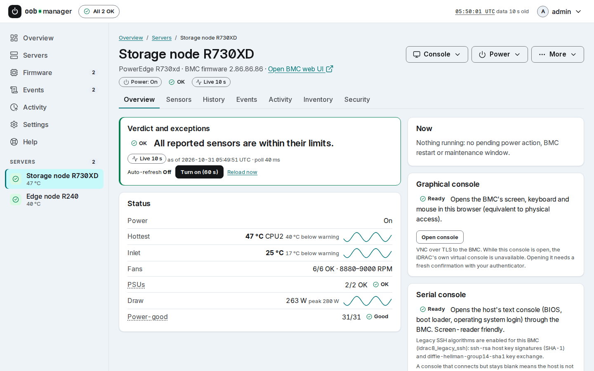
</picture>

<p align="center"><sub>All screenshots use the built-in mock BMCs: the data is synthetic.</sub></p>

oob-manager is one small container that talks Redfish to the iDRACs in your rack and puts them on one
page: health, sensor history, event logs, firmware versions and BMC security checks. Turn them on and it
also handles power, time-boxed fan boosts and the serial and graphical consoles in your browser. Each of
those needs a fresh TOTP code and leaves an entry in a hash-chained audit log. It is read-only by default
and built for a management LAN, not the internet.

> **Public beta.** Tested on one iDRAC8 and one iDRAC9 (see [Tested hardware](#tested-hardware)), but few
> people have run it yet. Redfish only: IPMI-only BMCs are not supported, and other Redfish BMCs are
> untested. Please [report your hardware](https://github.com/MrRonco/oob-manager/issues/new?template=hardware_report.yml), working or not.

## Why oob-manager

| | Stock iDRAC web UI | oob-manager |
|---|---|---|
| Sign-in | One login per BMC | One sign-in (password + TOTP) for every BMC |
| Sensors | Current readings; graphs depend on generation and licence | History: 7 days raw, hourly for 90 days, daily for 2 years, CSV export |
| Alerts | Email or SNMP traps, set up on each BMC | ntfy, Pushover, Gotify, webhook or email from one place, with maintenance windows |
| Consoles | HTML5 or Java plug-in, varies by generation and licence | Serial (over the BMC's SSH) and VNC in a browser tab; the BMC password stays on the server |
| Power | A confirm dialog | A page that says what goes down, a typed name for forced actions, a fresh TOTP code, a cooldown |
| Audit | The BMC's own log | A hash-chained log of every action, optionally shipped to a log server (GELF) |
| Firmware | Versions per server | Every component across servers in one table, optional check against Dell's signed catalog |
| Security posture | Up to you | Read-only checks of TLS, SSH, services, accounts and IP filter, with fixes |

The iDRAC UI stays the place for firmware installs, BIOS settings, RAID and virtual media: oob-manager
leaves those out on purpose ([feature reference](#feature-reference)).

## Feature tour

### Every server on one page
The page opens with a verdict: all healthy, the worst server, or the warning and critical events of the
last 24 hours. Below it, each server's hottest sensor over the last 24 hours, worst first, total power draw
and the newest log entries. Data that has gone stale is marked stale, never shown as current.

<picture>
  <source media="(prefers-color-scheme: dark)" srcset="docs/screenshots/overview-dark.png">
  <source media="(prefers-color-scheme: light)" srcset="docs/screenshots/overview-light.png">
  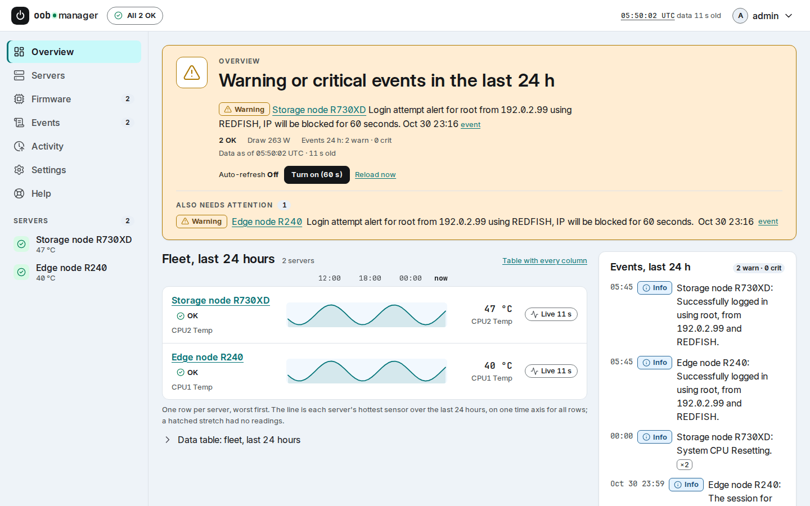
</picture>

### Sensor history
Every poll is kept: 7 days of raw readings, then hourly and daily roll-ups (adjustable). Pick a sensor to see
its range and numbers; the power actions, fan boosts and warnings of that period are listed under the charts.
Export any of it as CSV.

<picture>
  <source media="(prefers-color-scheme: dark)" srcset="docs/screenshots/history-dark.png">
  <source media="(prefers-color-scheme: light)" srcset="docs/screenshots/history-light.png">
  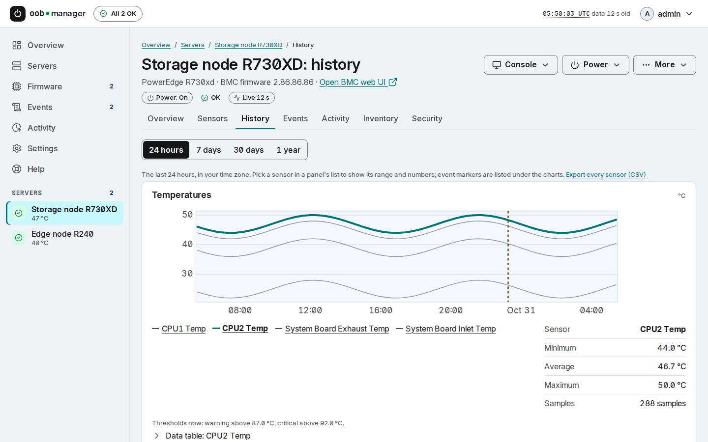
</picture>

### Consoles in the browser, no Java
The host's serial console through the BMC's own SSH, and the graphical console over VNC with TLS, both in a
browser tab. On an iDRAC9 you can also open its native HTML5 console with a one-time login. Consoles are off
until you enable them, and opening one needs an admin with a fresh TOTP code.

<table>
  <tr>
    <td width="50%">
      <picture>
        <source media="(prefers-color-scheme: dark)" srcset="docs/screenshots/console-serial-dark.png">
        <source media="(prefers-color-scheme: light)" srcset="docs/screenshots/console-serial-light.png">
        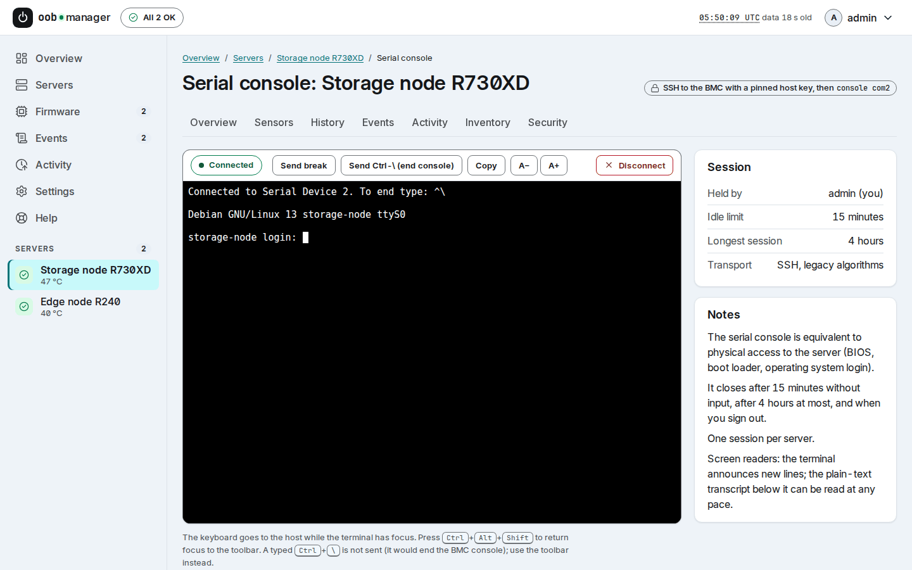
      </picture>
    </td>
    <td width="50%">
      <picture>
        <source media="(prefers-color-scheme: dark)" srcset="docs/screenshots/console-graphical-dark.png">
        <source media="(prefers-color-scheme: light)" srcset="docs/screenshots/console-graphical-light.png">
        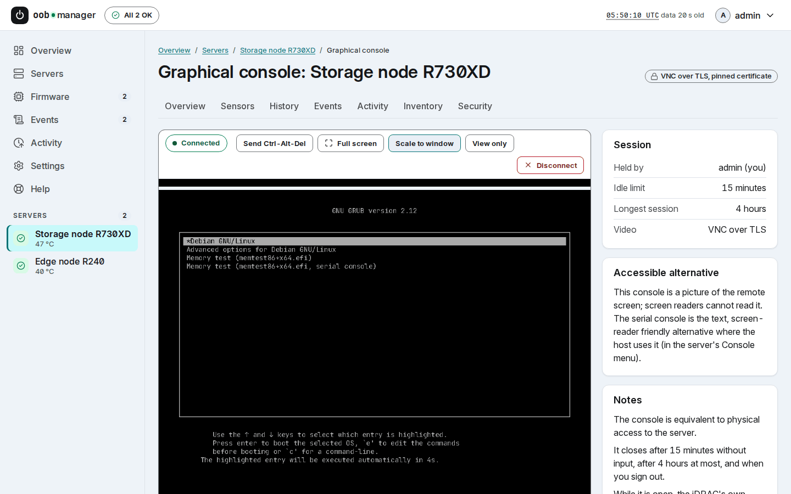
      </picture>
    </td>
  </tr>
</table>

### Power actions you have to mean
Each action gets its own page that says what happens and what goes down with the server. Forced actions ask
you to type the server's name and every action needs a fresh authenticator code. oob-manager writes the
audit row before anything is sent, watches the BMC until the change shows and waits a minute before the
next action on that server.

<picture>
  <source media="(prefers-color-scheme: dark)" srcset="docs/screenshots/power-confirm-dark.png">
  <source media="(prefers-color-scheme: light)" srcset="docs/screenshots/power-confirm-light.png">
  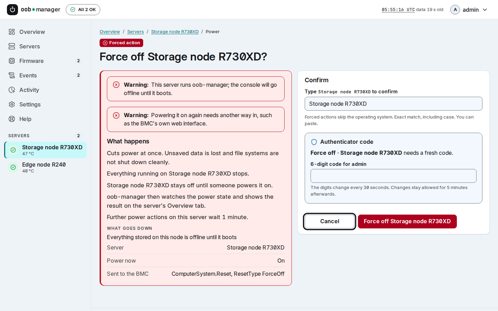
</picture>

### Firmware and security, side by side

<table>
  <tr>
    <td width="50%">
      <picture>
        <source media="(prefers-color-scheme: dark)" srcset="docs/screenshots/firmware-dark.png">
        <source media="(prefers-color-scheme: light)" srcset="docs/screenshots/firmware-light.png">
        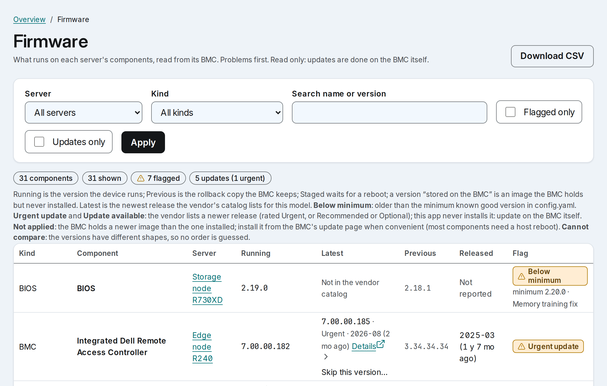
      </picture>
    </td>
    <td width="50%">
      <picture>
        <source media="(prefers-color-scheme: dark)" srcset="docs/screenshots/security-dark.png">
        <source media="(prefers-color-scheme: light)" srcset="docs/screenshots/security-light.png">
        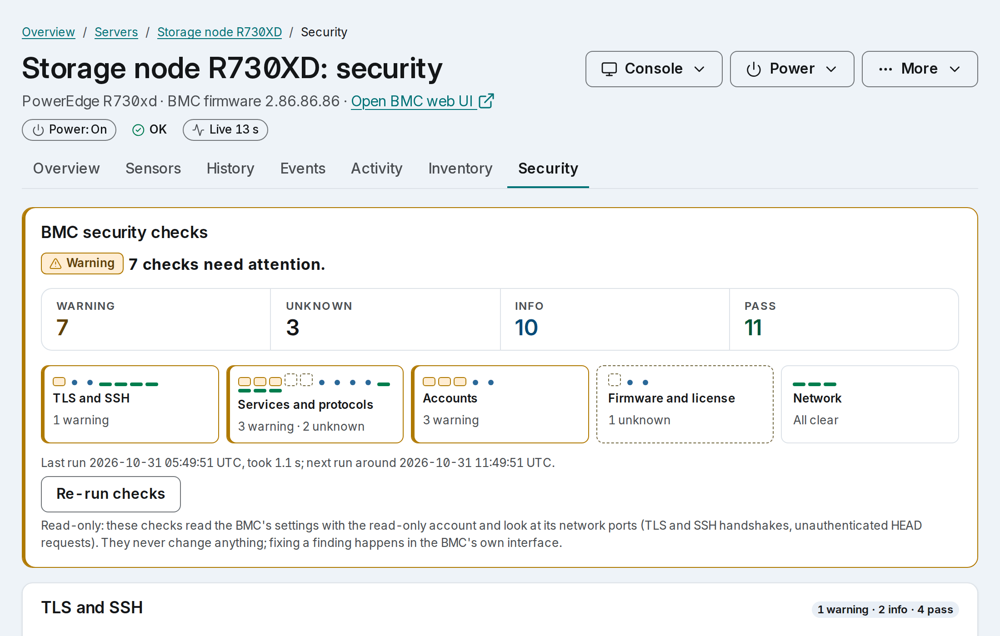
      </picture>
    </td>
  </tr>
</table>

**Firmware:** every component's running version across all servers, including images stored on the BMC but
never applied, and, if you switch it on, the latest Urgent or Recommended release from Dell's signed catalog.
oob-manager never installs firmware. **Security checks:** a read-only review of each BMC's TLS, SSH,
services, accounts, licence and IP filter, each finding with why it matters and what to change. On the
tested iDRAC8 and iDRAC9, no probe counted as a failed login.

### Events and activity

<table>
  <tr>
    <td width="50%">
      <picture>
        <source media="(prefers-color-scheme: dark)" srcset="docs/screenshots/events-dark.png">
        <source media="(prefers-color-scheme: light)" srcset="docs/screenshots/events-light.png">
        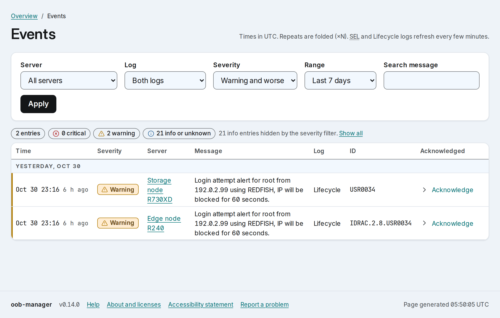
      </picture>
    </td>
    <td width="50%">
      <picture>
        <source media="(prefers-color-scheme: dark)" srcset="docs/screenshots/activity-dark.png">
        <source media="(prefers-color-scheme: light)" srcset="docs/screenshots/activity-light.png">
        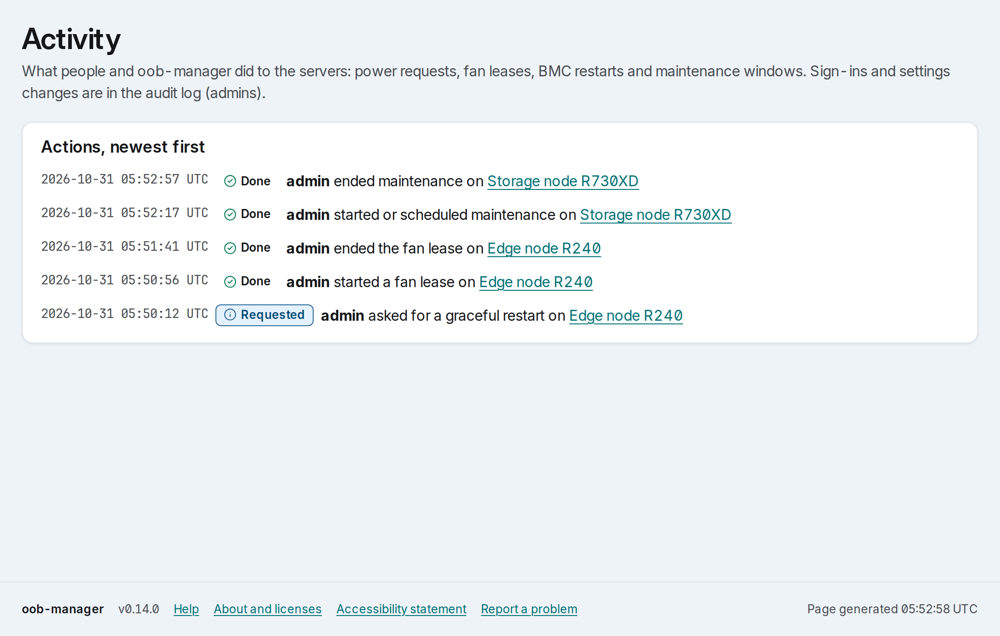
      </picture>
    </td>
  </tr>
</table>

The SEL and Lifecycle log of every server in one filterable list, with repeats folded and acknowledgements.
Activity shows what people and oob-manager did: power requests, fan boosts, BMC restarts and maintenance
windows.

### Keyboard first, settings in the browser

<table>
  <tr>
    <td width="50%">
      <picture>
        <source media="(prefers-color-scheme: dark)" srcset="docs/screenshots/palette-dark.png">
        <source media="(prefers-color-scheme: light)" srcset="docs/screenshots/palette-light.png">
        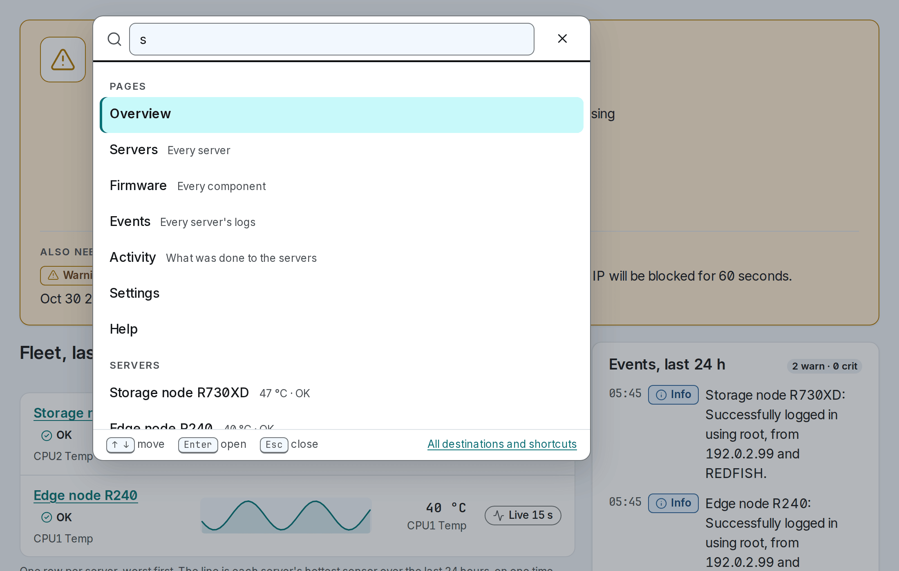
      </picture>
    </td>
    <td width="50%">
      <picture>
        <source media="(prefers-color-scheme: dark)" srcset="docs/screenshots/settings-servers-dark.png">
        <source media="(prefers-color-scheme: light)" srcset="docs/screenshots/settings-servers-light.png">
        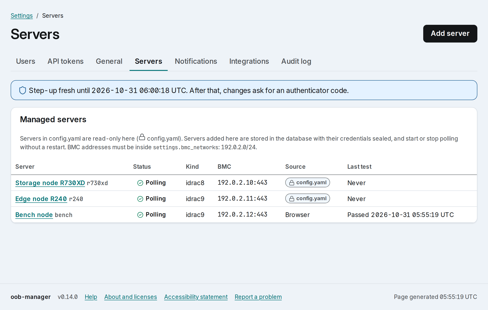
      </picture>
    </td>
  </tr>
</table>

`Ctrl`+`K` (`⌘`+`K` on a Mac) opens a list of every page and server to filter as you type; without
JavaScript it is the `/go` page. Add and test servers, pin their certificates on first use, and manage
users, API tokens and notifications in Settings. A `config.yaml` can still lock any part of it.

### On your phone

<table align="center">
  <tr>
    <td align="center">
      <picture>
        <source media="(prefers-color-scheme: dark)" srcset="docs/screenshots/phone-server-dark.png">
        <source media="(prefers-color-scheme: light)" srcset="docs/screenshots/phone-server-light.png">
        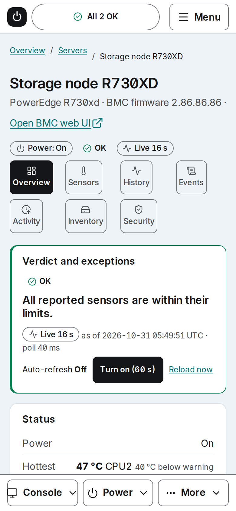
      </picture>
    </td>
    <td align="center">
      <picture>
        <source media="(prefers-color-scheme: dark)" srcset="docs/screenshots/phone-confirm-dark.png">
        <source media="(prefers-color-scheme: light)" srcset="docs/screenshots/phone-confirm-light.png">
        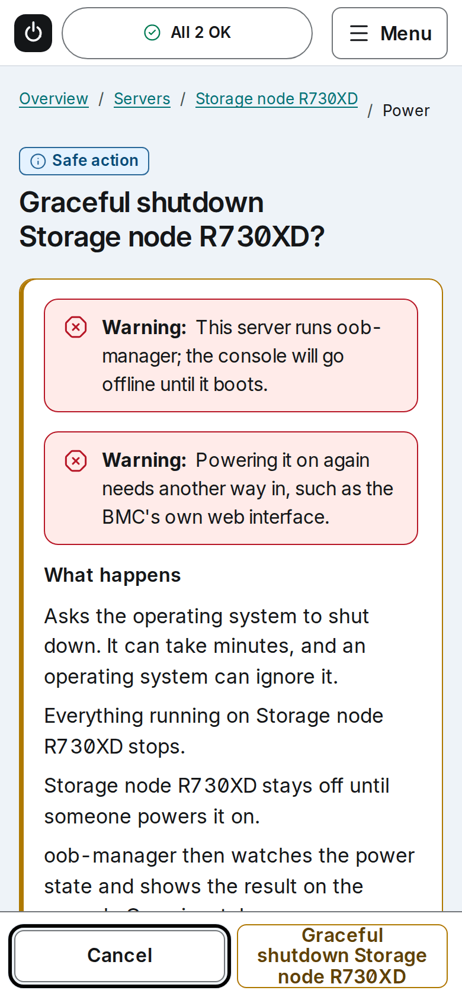
      </picture>
    </td>
  </tr>
</table>

Every page works at phone width, with the server's Console, Power and More menus in a bottom bar.

**Also included:** time-boxed fan boosts that always revert (iDRAC9 fan floor, or a lease file for a host fan
script), BMC restart, maintenance windows, server notes, six colour themes in light and dark, a read-only
JSON API with tokens ([OpenAPI](docs/api/openapi.yaml)), Prometheus `/metrics` and GELF audit shipping.

<a id="feature-reference"></a>
<details id="feature-reference-details">
<summary><strong>Feature reference</strong>: what each area does and how</summary>

| Area | What you get | How |
|---|---|---|
| Health and sensors | Overall health, temperatures, fans, PSUs, power draw, history graphs and CSV export | Redfish over HTTPS, pinned certificate |
| Event logs | SEL and Lifecycle log, acknowledgement, maintenance windows, notifications (ntfy, Pushover, Gotify, webhook, email) | Redfish |
| Firmware | Installed versions, stored-but-not-applied images, optional check against Dell's signed catalog | Redfish, read-only: it never installs firmware |
| BMC security checks | TLS, services, accounts, licences, IP filter and more, as findings with fixes | Redfish + TLS/SSH probes |
| Power | On, graceful shutdown or restart, force off, power cycle, BMC restart | Redfish `ComputerSystem.Reset`, operator account |
| Fans | Time-boxed fan floor that always reverts | iDRAC9 Redfish thermal floor, or a lease file for a host fan script |
| Consoles | Serial console over the BMC's SSH, VNC graphical console, iDRAC9 native console launch | BMC SSH (`console com2`), VNC over TLS |
| Integrations | Read-only JSON API with tokens, Prometheus `/metrics`, GELF audit shipping, snippets for dashboards and uptime monitors | |

Out of scope by design: virtual media, firmware updates, BIOS settings, BMC user management, Java
consoles and proxying the full iDRAC web UI.

</details>

## Quick start

Images are published to `ghcr.io/mrronco/oob-manager`, signed with cosign and shipped with SLSA provenance and an SBOM.
[Verify the image](docs/verify.md) before you run it, then pin its digest.

```yaml
# compose.yaml
name: oob-manager
services:
  oob-manager:
    image: ghcr.io/mrronco/oob-manager:<version>   # pin the digest you verified
    container_name: oob-manager
    restart: unless-stopped
    user: "65532:65532"
    read_only: true
    tmpfs: ["/tmp:size=16m,noexec,nosuid,nodev,mode=1777"]
    cap_drop: [ALL]
    security_opt: ["no-new-privileges:true"]
    pids_limit: 64
    mem_limit: 256m
    memswap_limit: 256m
    environment: { GOMEMLIMIT: "200MiB" }
    ports: ["192.0.2.20:8443:8443"]                # your host's LAN address, never 0.0.0.0
    volumes:
      - type: bind
        source: /srv/oob-manager/data
        target: /data
        bind: { create_host_path: false }
```

```bash
install -d -m 0700 -o 65532 -g 65532 /srv/oob-manager/data
docker compose up -d
docker logs oob-manager 2>&1 | grep -E 'fingerprint|setup code'
```

1. Open `https://192.0.2.20:8443/` and check the certificate fingerprint against the log.
2. A fresh install opens the first-run page, `/setup`. Enter the one-time **setup code** from the log (valid
   24 hours, single use). The page exists only until the first account is made.
3. Create the first administrator: a password and an authenticator app (TOTP).
4. Add your BMCs in **Settings › Servers**. Use a read-only BMC account; add an operator account only for
   the features you turn on ([privileges per feature](deploy/README.md#bmc-account-privileges-per-feature)).
5. Back up `/data/keys/age-identity` off the server when the banner asks. Without it, the stored BMC
   passwords and authenticator secrets cannot be read after a restore.

[deploy/README.md](deploy/README.md) has the rest: the hardened layout with mounted keys, TLS, turning on
each feature, upgrades, backups and the recovery runbook. No hardware? `make dev` runs the app against mock
BMCs (see [CONTRIBUTING.md](CONTRIBUTING.md)).

### Unraid

A Community Applications listing is coming. Until then, use the draft template in
[deploy/unraid](deploy/unraid/) or a Compose Manager project, as described in the
[Unraid section of the deploy guide](deploy/README.md#unraid). Keep the container out of CA Auto Update:
an upgrade can migrate the database, and migrations are one-way.

## Security model

- **No default credentials.** The first admin is created with a one-time setup code or the `bootstrap-admin` CLI.
- **Password and TOTP for every account**, served over HTTPS only.
- **Read-only out of the box.** Power, BMC restart, fan boosts and the consoles stay off until you give a
  server an operator account and enable the feature.
- **Dangerous actions need a role, a fresh TOTP step-up and a rate limit**, and the audit row is written
  first: if it cannot be written, nothing is sent to the BMC.
- **Hash-chained audit log**, verifiable from the UI or the CLI. Ship it to a log server (GELF) so that
  deleted or rewritten rows can be detected too.
- **Pinned and sealed.** BMC certificates and SSH host keys are pinned on first use, before any password is
  sent. BMC passwords and TOTP secrets are sealed with age.
- **LAN-only by design.** Publish it on one LAN address, never `0.0.0.0` or a public tunnel. Servers added
  in the browser must sit inside `settings.bmc_networks` (private ranges by default).
- **Hardened container.** Non-root and distroless, with a read-only root filesystem, no capabilities and no
  shell. Every API token is read-only.

It cannot patch BMC firmware, and someone with an admin's password and authenticator can do what that admin
can. The threat model and accepted risks are in [docs/security.md](docs/security.md); report vulnerabilities
as described in [SECURITY.md](SECURITY.md).

<details>
<summary>The details</summary>

The app is LAN-only by design and safe by default: there are no default credentials (the first
administrator is created with a one-time setup code or the `bootstrap-admin` CLI), every account
signs in with a password and TOTP, and the UI is served over HTTPS only. Out of the box it is
read-only: power, BMC restart, fan leases and the consoles stay off until you give a server an
operator account and enable the feature, and each of them then needs the operator role (admin for
the hard power actions, BMC restart and the consoles), a fresh TOTP step-up, a rate limit and an
audit row in a hash-chained log. The one exception is ending a fan lease early: it only restores
the normal fan curve, so it needs the operator role but no step-up. BMCs are reached only at the
addresses an administrator entered, inside `settings.bmc_networks`, with their TLS certificate or
SSH host key pinned on first use before any password is sent; BMC passwords and TOTP secrets are
sealed with age. The container runs as a non-root user on a read-only, distroless image with no
shell. The threat model is in [docs/security.md](docs/security.md); report vulnerabilities as
described in [SECURITY.md](SECURITY.md).

</details>

## Tested hardware

| BMC | Firmware | Server | Status |
|---|---|---|---|
| Dell iDRAC8 | 2.86 | PowerEdge R730XD | Tested on real hardware |
| Dell iDRAC9 | 7.00 | PowerEdge R240 | Tested on real hardware |
| Other Dell generations, generic Redfish, HPE iLO, Lenovo XCC, Supermicro, OpenBMC | | | **Untested** |

Everything not in the first two rows is untested. If you try it on anything else, please open a
[hardware report](https://github.com/MrRonco/oob-manager/issues/new?template=hardware_report.yml),
whether it works or not. [docs/hardware.md](docs/hardware.md) has the feature-by-feature table and
the known quirks. Power control and BMC restart have so far run only against the mock BMCs, apart from
a graceful restart on the iDRAC9.

## Status and roadmap

oob-manager is a **public beta**. Releases stay 0.x until `v1.0.0`, which follows once hardware reports have
come in and a month has passed without a security fix. Read the [CHANGELOG](CHANGELOG.md) before you
upgrade: migrations are one-way, so back up first. Next up: the Unraid Community Applications listing, and
support for other Redfish vendors once someone with the hardware can test it. What is planned and what is
done is in [docs/task_list.md](docs/task_list.md).

## Verifying images

Every release image is signed with cosign (keyless, from this repository's release workflow) and
carries SLSA provenance and an SPDX SBOM. [docs/verify.md](docs/verify.md) shows how to check all
three before you run it, and how to verify the release binaries against `checksums.txt`.

## Support

- **Bugs and questions:** [GitHub issues](https://github.com/MrRonco/oob-manager/issues/new/choose).
- **Hardware reports**, working or not: [the hardware report form](https://github.com/MrRonco/oob-manager/issues/new?template=hardware_report.yml).
  Anonymise it first ([what to remove](docs/hardware.md#sending-a-hardware-report)).
- **Security issues:** never in a public issue. See [SECURITY.md](SECURITY.md).

An as-is homelab project, answered on a best-effort basis; security reports come first.

If oob-manager saves you a trip to the server room, you can buy me a coffee.

<a href="https://www.buymeacoffee.com/mrronco"></a>

## Contributing

Contributions are welcome: see [CONTRIBUTING.md](CONTRIBUTING.md) (tests first, DCO sign-off) and the
[Code of Conduct](CODE_OF_CONDUCT.md). `make dev` gives you the full app against mock BMCs.

## Documentation

| Doc | Contents |
|---|---|
| [deploy/README.md](deploy/README.md) | Install, configuration, enabling features, upgrades, backups, recovery |
| [docs/verify.md](docs/verify.md) | Verifying an image's signature, provenance and SBOM |
| [docs/hardware.md](docs/hardware.md) | Tested hardware and how to report yours |
| [CHANGELOG.md](CHANGELOG.md) | What changed in each release |
| [docs/security.md](docs/security.md) | Threat model, controls, BMC account plan |
| [docs/architecture.md](docs/architecture.md) | Components, trust boundaries, deployment |
| [docs/system_design.md](docs/system_design.md) | Driver model, fan lease, console design |
| [docs/tech_doc.md](docs/tech_doc.md) | Stack, libraries, data model, API, implementation notes |
| [docs/api/openapi.yaml](docs/api/openapi.yaml) | The JSON API |
| [docs/PRD.md](docs/PRD.md), [docs/task_list.md](docs/task_list.md), [docs/plans/](docs/plans/) | Requirements, phased plan, design plans |

<details>
<summary>Stack</summary>

Go, one static binary, on a digest-pinned distroless image. Redfish through the app's own guarded
HTTP client with [gofish](https://github.com/stmcginnis/gofish) schema types, BMC SSH via
`golang.org/x/crypto/ssh`, no shell-outs, server-rendered HTML with vendored xterm.js and noVNC, and pure-Go
SQLite. Third-party notices are in [NOTICE](NOTICE).

</details>

## License

[Apache License 2.0](LICENSE). Dell, iDRAC and PowerEdge are trademarks of Dell Inc.; this project is not
affiliated with or endorsed by Dell.
